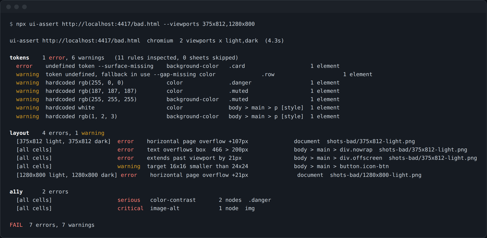

# ui-assert



Point it at a running page and it tells you, in a few lines of text, whether the UI is actually right: which colours bypass your design tokens, which tokens are referenced but never defined, what overflows or gets clipped at each viewport, which tap targets are too small, and what axe finds. It exits non-zero when something is wrong.

It exists because coding agents can build UI but can't prove it. Screenshots cost a fortune in tokens and still leave the agent guessing, linters never see the rendered page, and pixel diffs say *that* something changed, not *what's wrong*. `ui-assert` gives an agent, a CI job, or a person one call that answers "is this fine?" with reasons.

```
$ npx ui-assert http://localhost:5173/settings

ui-assert http://localhost:5173/settings  chromium  3 viewports x light,dark  (4.8s)

tokens    1 error, 2 warnings   (412 rules inspected, 0 sheets skipped)
  error    undefined token --surface-primary    background-color   .Card_root_x1   4 elements
  warning  hardcoded rgb(255, 0, 0)             color              .danger         1 element
  warning  hardcoded rgb(1, 2, 3)               background-color   body > main > p [style]  1 element

layout    2 errors, 1 warning
  [375x812 light, 375x812 dark]  error    horizontal page overflow +107px   document   ui-assert-out/375x812-light.png
  [all cells]                    error    text overflows box  466 > 200px   main > div.Row > h2.Title
  [all cells]                    warning  target 16x16 smaller than 24x24   button.IconBtn

a11y      1 error
  [all cells]   critical  image-alt   1 node   img   https://dequeuniversity.com/rules/axe/4.13/image-alt

FAIL  4 errors, 3 warnings
```

Only problems are listed. A clean page prints three `ok` lines and `PASS`.

## Install

```
npm i -D ui-assert
npx playwright install chromium
```

Node 20 or newer. Chromium is the default browser; `--browser firefox` and `--browser webkit` work if you've installed them.

## What it checks

**tokens.** It walks the stylesheets the page actually loaded and looks at the colour properties of every rule that applies to at least one element on screen. A value written as `var(--something)` is token-derived; a literal (`#fff`, `rgb(...)`, `white`, a gradient) is reported as hardcoded. Then, for every token that's referenced, it reads the computed value off the matching elements. If it comes back empty the token was never defined for that element in that theme. Browsers drop invalid custom properties silently, so the component just inherits something and looks almost right. No static tool can catch this; it needs the rendered page.

Inline `style` attributes get the same treatment. Stylesheets from `node_modules` are skipped unless you ask for them.

**layout.** For each viewport and colour scheme: horizontal page overflow, text that overflows its box or is clipped without an ellipsis, content clipped vertically, elements that extend past the viewport edge, and interactive targets smaller than 24×24 CSS pixels (WCAG 2.2, 2.5.8). Cells with errors get a screenshot in `ui-assert-out/`; cells that pass don't.

**a11y.** axe-core through `@axe-core/playwright`, once per cell, because contrast changes between light and dark. Critical and serious impacts are errors, moderate and minor are warnings.

Findings that repeat across cells are collapsed to one line that says where they happened, and the summary counts distinct problems, not problem × cell.

## Options

```
ui-assert <url> [options]

  --scope <selector>        restrict tokens + layout checks to a subtree (default: body)
  --viewports <list>        default 375x812,768x1024,1280x800
  --schemes <list>          default light,dark
  --theme-attr <name>       also set this attribute on <html> to the scheme name,
                            for apps that switch theme with e.g. data-theme="dark"
  --browser <name>          chromium (default) | firefox | webkit
  --wait <selector|ms>      after load, wait for a selector or extra ms (default 250)
  --token-prefix=<str>      only custom properties with this prefix count as tokens;
                            any other var() is reported. Use the = form, since the
                            value starts with dashes: --token-prefix=--ds-
  --props <list>            CSS properties the tokens check inspects
  --ignore <selectors>      comma-separated selectors skipped in all checks
  --include-third-party     also inspect node_modules stylesheets
  --strict-tokens           hardcoded colours are errors instead of warnings
  --no-tokens --no-layout --no-a11y
  --json                    JSON report to stdout
  --out <dir>               failing-cell screenshots (default ./ui-assert-out)
  --fail-on error|warning|none   (default error)
  --config <path>           JSON file with the same options in camelCase
```

Flags that pile up are better kept in a `ui-assert.config.json` next to your `package.json`; it's read automatically, and anything you pass on the command line still wins:

```json
{
  "url": "http://localhost:5173/",
  "scope": "main",
  "themeAttr": "data-theme",
  "ignore": ["[data-agentation-root]"],
  "tokenPrefix": "--",
  "failOn": "warning"
}
```

The default properties are `color`, `background-color`, the four `border-*-color`s, `outline-color`, `fill`, `stroke`, `caret-color`, `text-decoration-color` and `accent-color`. Add `background-image` if you want gradients caught, or spacing properties if your tokens cover those too.

## Using it from an agent

The text output is meant to be pasted straight into a model's context. A Claude Code hook that runs after every file edit and hands the verdict back looks like this in `.claude/settings.json`:

```json
{
  "hooks": {
    "PostToolUse": [
      {
        "matcher": "Edit|Write",
        "hooks": [
          {
            "type": "command",
            "command": "npx ui-assert http://localhost:5173/ --scope main --fail-on warning || true"
          }
        ]
      }
    ]
  }
}
```

For CI, drop `|| true` and let the exit code fail the job. `--json` gives you the same data with per-cell detail if you want to post-process it.

Dev-only overlays (an annotation toolbar, a devtools panel) tend to ship their own colours and tiny buttons. Keep them out of the verdict with `--ignore`, e.g. `--ignore "[data-agentation-root]"`.

Storybook stories are just URLs: `ui-assert "http://localhost:6006/iframe.html?id=button--primary&viewMode=story" --scope "#storybook-root"`.

## MCP server

The same checks are available to an agent as an MCP tool, so it can verify its own work without you wiring up a hook. Add it to Claude Code with:

```
claude mcp add ui-assert -- npx -y -p ui-assert ui-assert-mcp
```

The `-p` is needed because the binary is called `ui-assert-mcp` but lives in the `ui-assert` package. The same thing in a `.mcp.json`, or Cursor's `mcp.json`:

```json
{
  "mcpServers": {
    "ui-assert": {
      "command": "npx",
      "args": ["-y", "-p", "ui-assert", "ui-assert-mcp"]
    }
  }
}
```

If the package is already a dev dependency, `"command": "ui-assert-mcp"` with no args works too and skips the registry lookup.

The server exposes one tool, `ui_assert`, taking the same options as the CLI in camelCase. It returns the text verdict you'd get on the command line, or the full JSON report with `format: "json"`. A FAIL comes back as a normal result the agent can read and act on, not an error; errors are reserved for a run that couldn't happen at all, such as a missing browser or a page that wouldn't load.

## Programmatic use

```ts
import { run, formatText } from "ui-assert";

const report = await run({ url: "http://localhost:5173/", scope: "main" });
console.log(formatText(report));
if (!report.summary.passed) process.exit(1);
```

`run` takes the same options as the CLI in camelCase and resolves to the full report; the types are exported.

## Limitations

- Shadow DOM: stylesheets and elements inside shadow roots aren't inspected by the tokens and layout checks. axe does look inside them.
- Cross-origin stylesheets can't be read without CORS headers. They're counted and reported as skipped, never silently ignored.
- Styles that only exist in `adoptedStyleSheets` aren't enumerated by `document.styleSheets` and are missed.
- `color-mix()` and relative colour syntax are treated as literals even when every argument is a `var()`.
- The undefined-token check reads computed styles off elements that are in the DOM right now. A token used only by a modal, another route or a hover state isn't checked until that state is on screen. Drive the page there first, or use `--wait`.
- Rules inside media and container queries are inspected whether or not the query currently matches. The "applies to at least one element" filter keeps this mostly quiet.
- `--theme-attr` flips the attribute after load, so an app that reads its theme once at startup may not react.
- The target-size check implements the inline-link exception from WCAG 2.5.8 but not the spacing exception.
- The layout scan looks at the first 5000 elements in scope and reports at most 25 findings per kind per cell; the tokens check stops at 50 per kind and says so.

## Licence

MIT
